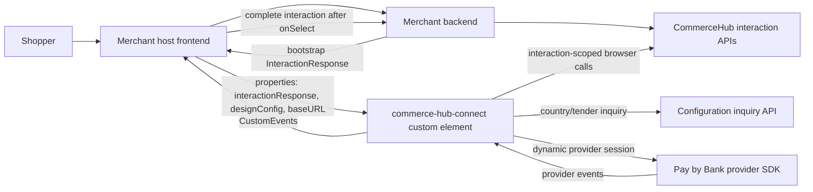
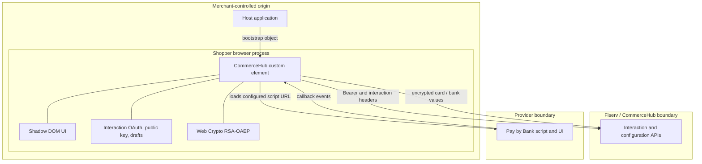
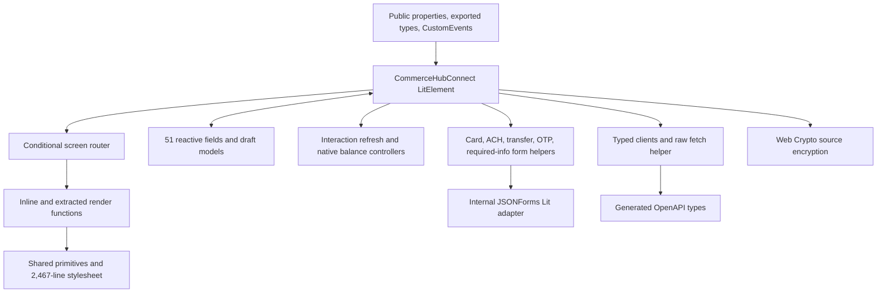
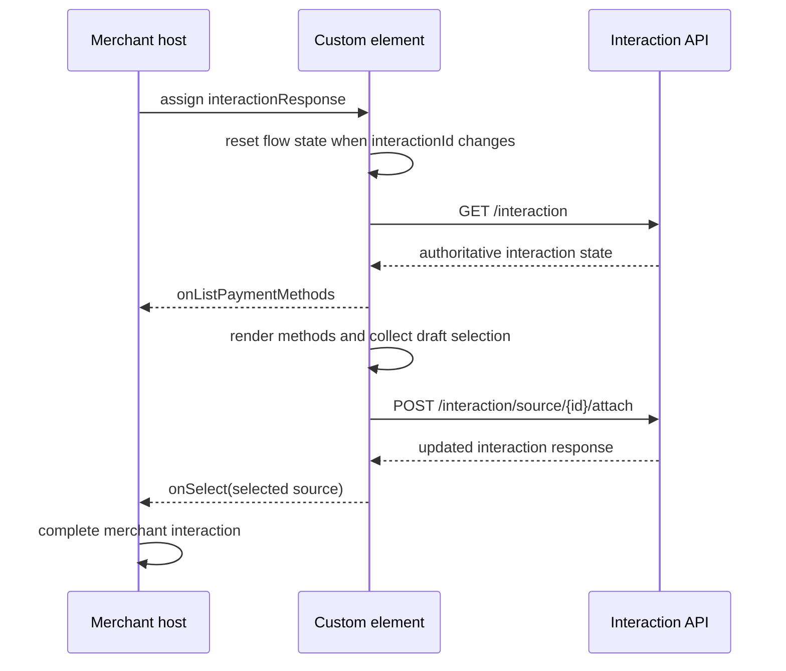
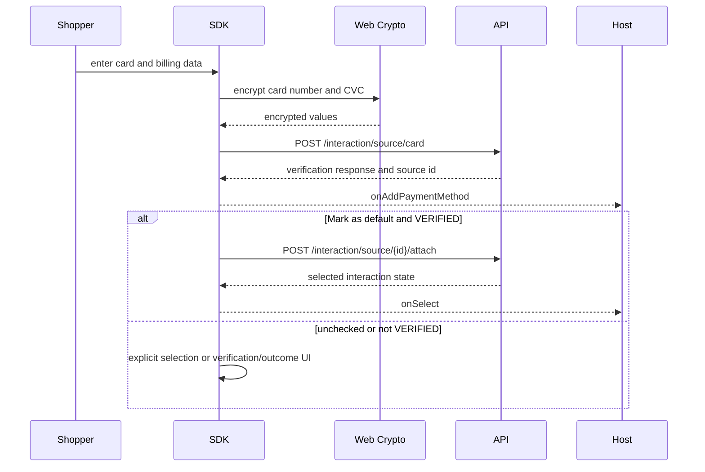
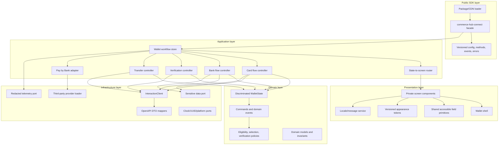
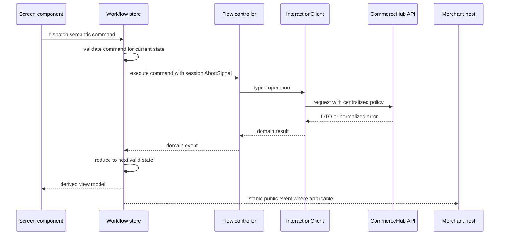
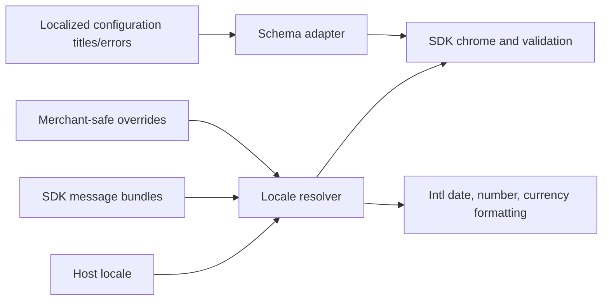
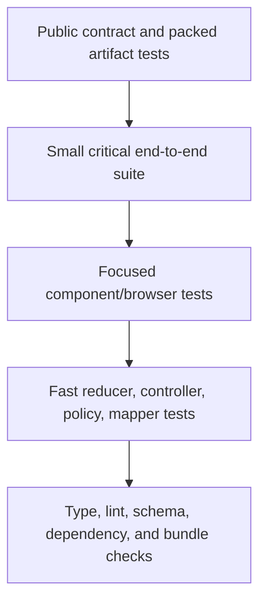

# CommerceHub Connect Wallet SDK Architecture Assessment

**Assessment date:** 24 July 2026
**Repository:** `commercehub-connect-wallet-sdk`
**Assessed version:** `0.9.9`, branch `feature/instrument-schema-update`, HEAD `12c6b3e`
**Audience:** SDK engineering, frontend architecture, API engineering, security, product, QA, and developer experience

## 1. Executive summary

CommerceHub Connect is a capable, framework-neutral payment wallet SDK delivered as a Lit custom element. It already supports a broad set of flows: interaction refresh, OTP, saved payment-source selection, card and ACH creation, local encryption, source verification, required-information collection, Pay by Bank, native-account balances, transfers, design tokens, and typed OpenAPI clients. The use of a single standards-based custom element, Shadow DOM, strict TypeScript, generated API types, explicit host events, and meaningful browser coverage gives the SDK a sound integration foundation.

The principal architectural risk is concentration. `src/commerce-hub-connect.ts` is 7,374 lines and contains approximately 51 reactive state fields and 140 component methods. It simultaneously acts as public adapter, router, state store, workflow engine, API orchestrator, error mapper, sensitive-data coordinator, third-party SDK loader, and screen presenter. That concentration makes invalid state combinations possible, increases regression risk, complicates cancellation and observability, and makes each new payment method or locale disproportionately expensive.

The recommended direction is an incremental modularization that preserves `<commerce-hub-connect>` and its public contract while moving behavior behind explicit ports:

1. Retain the custom element as the stable host-facing facade.
2. Introduce a typed interaction client as the only network boundary.
3. Replace loosely related booleans and screen flags with a discriminated workflow state and explicit commands/events.
4. Extract card, bank, verification, transfer, and Pay by Bank flow controllers and screen components one vertical slice at a time.
5. Add a formal error, cancellation, telemetry, locale, release, and compatibility contract.
6. Treat hosted sensitive fields or an isolated iframe as a strategic security option requiring PCI and product review, not as a casual refactor.

This is not a recommendation for a big-bang rewrite. The current behavioral test suite and public element can serve as a compatibility harness while internals are replaced incrementally.

## 2. Scope and method

This assessment covers:

- public SDK integration and lifecycle;
- UI composition and state management;
- payment workflow orchestration;
- API and configuration boundaries;
- sensitive-data handling and third-party scripts;
- extensibility, localization, accessibility, and theming;
- package, build, release, and documentation structure;
- automated test architecture and operational readiness.

The assessment is based on repository inspection, not a runtime penetration test, PCI assessment, production traffic review, or backend contract audit. Security and compliance conclusions must be validated by the responsible security team and, where applicable, a PCI-qualified assessor.

### 2.1 Quantitative snapshot

| Measure                               |                         Observed value | Architectural implication                                          |
| ------------------------------------- | -------------------------------------: | ------------------------------------------------------------------ |
| Root component                        |                            7,374 lines | Too many responsibilities share one change surface.                |
| Root component reactive fields        |                                     51 | Implicit combinations can represent invalid workflow states.       |
| Root component methods                |                      Approximately 140 | Orchestration, rendering, and domain behavior are tightly coupled. |
| Main flow test file                   |                            7,193 lines | Good behavioral investment, but slow to understand and isolate.    |
| SDK TypeScript and test code measured |             Approximately 31,000 lines | The product is beyond a “single widget” architecture.              |
| Browser test cases                    |                                    215 | Strong regression base for incremental refactoring.                |
| Unbundled root JavaScript             |    Approximately 207 KiB / 33 KiB gzip | Reasonable today, but no enforced budget prevents growth.          |
| Public custom elements                |            One intended public element | A good stable facade for internal modularization.                  |
| Network implementations               | Typed `openapi-fetch` plus raw `fetch` | Error, cancellation, and header behavior can diverge.              |

## 3. Architectural drivers

The architecture should optimize for the following qualities, in order:

1. **Payment correctness and security:** never attach, verify, delete, or submit a different source from the one the shopper intended; minimize sensitive-data exposure.
2. **Integration stability:** preserve a small, versioned host contract across plain HTML, React, Angular, and other frameworks.
3. **Recoverability:** make network, verification, provider, and validation failures explicit and retryable without corrupting state.
4. **Extensibility:** add tenders, countries, schemas, and verification steps without expanding a central conditional router.
5. **Accessibility and localization:** support keyboard, assistive technology, locale-aware copy, and regional forms as first-class contracts.
6. **Testability:** test workflow decisions without a browser and render/accessibility behavior with focused components.
7. **Operability:** correlate failures with interaction and SDK version while excluding secrets and payment data.
8. **Performance:** keep initial payload, render time, and third-party provider loading predictable.

## 4. Current system context



### 4.1 Trust boundaries



Client-side encryption protects values in transit beyond the encryption point, but the plain values, interaction token, and encryption operation exist in the merchant page's JavaScript realm. Shadow DOM is a styling and encapsulation mechanism, not a security boundary. Any PCI-scope claim therefore requires formal validation.

## 5. Current logical architecture



### 5.1 Responsibilities by area

| Area                 | Current implementation                                                                    | Assessment                                                                                        |
| -------------------- | ----------------------------------------------------------------------------------------- | ------------------------------------------------------------------------------------------------- |
| Public facade        | `<commerce-hub-connect>` properties and non-bubbling `CustomEvent`s                       | Appropriate integration primitive; contract needs stronger lifecycle/version semantics.           |
| Screen routing       | Ordered `if` statements in `renderCurrentScreen()`                                        | Easy initially, but priority-dependent and not an explicit state machine.                         |
| State                | Lit `@state` fields plus controller-owned state                                           | Reactive and simple, but distributed and capable of contradictory combinations.                   |
| Forms                | Pure helpers for several drafts; dynamic bank forms via JSONForms                         | Good extraction trend; two form paradigms increase consistency burden.                            |
| API                  | `openapi-fetch` clients and a local raw JSON request helper                               | Typed where used, but transport policies are duplicated.                                          |
| Security             | Web Crypto RSA-OAEP SHA-512; headers derived from interaction response                    | Useful defense, but secrets/tokens remain in page memory and errors need redaction policy.        |
| Third-party provider | Dynamically loaded Pay by Bank SDK with request tokens and teardown                       | Cancellation effort exists; supply-chain, CSP, version pinning, and isolation need formalization. |
| Presentation         | Shadow DOM, CSS custom properties, parts, primitives                                      | Strong theming base; monolithic stylesheet and hard-coded copy limit scale.                       |
| Tests                | Browser flow, selection, accessibility, primitives, API client, form and encryption tests | Broad coverage; domain decisions are still expensive browser tests.                               |
| Packaging            | ESM package plus Rollup CDN bundle and generated declarations                             | Basic delivery works; metadata/release and artifact governance are incomplete.                    |

## 6. Current flow behavior

### 6.1 Bootstrap and selection



The host response is bootstrap state, while a subsequent SDK refresh becomes authoritative. This is documented, but the property name does not convey ownership or lifecycle, and assigning SDK-derived state internally to the same conceptual object makes the boundary harder to reason about.

### 6.2 Card creation and conditional attach



### 6.3 Dynamic non-US bank flow

```mermaid
flowchart LR
    Country[Select country] --> Inquiry[Configuration inquiry]
    Inquiry --> Currency[Select unique currency]
    Currency --> Account[Select Business or Personal]
    Account --> Payment[Select payment type]
    Payment --> Schema[Resolve exact instrument schema]
    Schema --> Form[Generate JSON Schema form]
    Form --> Address[Resolve/create billing address]
    Address --> Encrypt[Encrypt sensitive account values]
    Encrypt --> Create[POST ACH source]
    Create --> Outcome{Verification status}
    Outcome -->|VERIFIED| Select[Return selected to method list]
    Outcome -->|other| Verification[Outcome / verification UI]
```



This demonstrates valuable configuration-driven extensibility, but the adapter, schema selection, UI schema generation, address pseudo-field, encryption, API orchestration, and outcome routing are still coordinated by the root element.

## 7. Strengths to preserve

1. **Standards-based integration.** A custom element avoids framework lock-in and can be hosted from plain HTML, Angular, React, or Lit.
2. **Small intended public UI surface.** One public element is easier to version than exposing internal screen components.
3. **Strict TypeScript and generated contracts.** Strict compiler settings and OpenAPI-generated types reduce accidental contract drift.
4. **Shadow DOM theming contract.** CSS custom properties and `::part` provide controlled merchant customization.
5. **Pure form and adapter helpers.** Card, bank, instrument-schema, manual-request, OTP, and transfer helpers are a good extraction direction.
6. **Server-authoritative interaction refresh.** Refreshing from the service avoids trusting stale host-provided payment-source data.
7. **Local sensitive-field encryption.** Encryption before source-create calls is better than transmitting raw values to an intermediate merchant service, subject to the caveats above.
8. **Accessibility investment.** Dedicated accessibility tests, semantic primitives, focus restoration, live regions, and busy states are visible in the design.
9. **Behavioral coverage.** The existing 215 browser test cases are an important compatibility safety net.
10. **Partial controller extraction.** Refresh and native-balance controllers show that lifecycle-aware logic can be moved out of the root without changing the public element.

## 8. Gap and risk register

Priorities use **P0** for release-blocking/security-critical work, **P1** for high architectural risk, **P2** for important scale/quality work, and **P3** for optimization.

| Priority | Gap                                                                                             | Evidence                                                                                                     | Risk                                                                                                          | Recommendation                                                                                                                                                                                      |
| -------- | ----------------------------------------------------------------------------------------------- | ------------------------------------------------------------------------------------------------------------ | ------------------------------------------------------------------------------------------------------------- | --------------------------------------------------------------------------------------------------------------------------------------------------------------------------------------------------- |
| P0       | Sensitive fields share the merchant page JavaScript realm                                       | Card and bank drafts are held in the root component and encrypted with Web Crypto                            | XSS or compromised host scripts can observe data before encryption; PCI scope may be larger than expected     | Obtain a formal PCI threat model. Evaluate hosted fields or an isolated, provider-controlled iframe for PAN/CVC and bank credentials. Never market Shadow DOM or client encryption as isolation.    |
| P0       | Browser token and credential contract needs formal threat modeling                              | OAuth access token and client metadata arrive in `interactionResponse` and are used in browser requests      | Token theft, over-broad token capabilities, replay, and accidental logging                                    | Require short-lived, interaction-scoped, least-privilege tokens; document TTL/audience; prohibit refresh tokens; redact headers and payloads; adopt CSP guidance.                                   |
| P0       | Pay by Bank defaults include environment-specific identifiers and a remote script URL in source | `DEFAULT_PAY_BY_BANK_OPTIONS` supplies QA values and SDK URL                                                 | Accidental non-production coupling, supply-chain exposure, CSP deployment failures                            | Remove environment identifiers from production defaults, pin/version provider assets, validate allowed origins, document CSP, and prefer a provider-owned loader with integrity/version guarantees. |
| P1       | Root component is a “god object”                                                                | 7,374 lines, 51 reactive fields, approximately 140 methods                                                   | High regression and onboarding cost; payment methods cannot evolve independently                              | Keep the element as facade; extract workflow store, flow controllers, screens, and service ports by vertical slice.                                                                                 |
| P1       | Workflow state is implicit                                                                      | Independent `bankFlowScreen`, `cardFlowScreen`, flags, overlays, selected sources, and pending action        | Invalid combinations and priority-dependent routing; hard-to-prove transitions                                | Introduce a discriminated `WalletState` and reducer/state machine with explicit commands, events, and invariants.                                                                                   |
| P1       | Two network stacks                                                                              | Typed OpenAPI clients coexist with `requestCommerceHubJson()` raw fetch calls                                | Divergent error parsing, headers, abort behavior, typing, and telemetry                                       | Create one `InteractionClient` adapter using generated paths; centralize auth headers, redaction, error normalization, timeout, and cancellation.                                                   |
| P1       | Stale async work is only partially controlled                                                   | Some flows use request tokens/controllers; many fetches do not accept `AbortSignal`                          | A previous interaction or screen can overwrite current state; wasted provider/network work                    | Create a session-scoped `AbortController`; abort on interaction change/disconnect; require operation tokens for third-party callbacks.                                                              |
| P1       | Public error event exists but is not used                                                       | `onError` types/constants are reserved while many caught errors are rendered or discarded                    | Hosts cannot distinguish configuration, transient, provider, and terminal failures or correlate support cases | Define a stable `SdkError` taxonomy and emit safe, redacted error events alongside recoverable inline UI.                                                                                           |
| P1       | Errors are sometimes swallowed                                                                  | Multiple `catch (cause) { void cause; }` sites                                                               | Silent failure impairs support and can hide state divergence                                                  | Route all failures through a policy: user-visible, host-visible, telemetry-only, or intentionally ignored with a reason code.                                                                       |
| P1       | Public lifecycle is underspecified                                                              | Inputs are properties and success events; no ready, loading, cancel, destroy, or programmatic retry contract | Host applications infer state from DOM or timing                                                              | Add typed lifecycle events/state: `ready`, `statechange`, `error`, and `cancel`; expose minimal imperative `refresh()`/`destroy()` only if needed.                                                  |
| P1       | “Mark as default” may not match attach semantics                                                | UI label drives attach to the current interaction                                                            | Shopper may interpret it as a persistent wallet default                                                       | Confirm backend semantics. If attach only selects for this interaction, rename to “Use this payment method” or add a true default-source API.                                                       |
| P2       | Localization is incomplete                                                                      | Most labels and errors are hard-coded English; Pay by Bank and JSONForms have isolated locale support        | Multi-language support becomes a cross-cutting rewrite; dynamic API copy may not match SDK chrome             | Add a public `locale`, message-key catalog, fallback rules, `Intl` formatting, and a host translation override contract. Define whether configuration APIs localize titles/errors.                  |
| P2       | Screen/component boundaries are incomplete                                                      | OTP and payment methods have extracted render modules; most other screens remain in root                     | Inconsistent patterns and large test fixtures                                                                 | Extract presentational Lit components with typed view models and semantic internal events; keep them private exports.                                                                               |
| P2       | Two form architectures                                                                          | Hand-built card/legacy ACH forms and JSONForms dynamic bank forms                                            | Validation, accessibility, copy, focus, and layout can diverge                                                | Define a shared field/view-model contract and renderer primitives; keep JSON Schema adaptation at a boundary.                                                                                       |
| P2       | Remote schema patterns are executed client-side                                                 | Configuration inquiry supplies regex and constraints adapted to JSON Schema                                  | Pathological regex can degrade UI responsiveness; incompatible patterns can break forms                       | Validate schema size and supported keywords, bound string lengths, reject unsafe patterns, and version the schema contract. Consider server-side validation as authoritative.                       |
| P2       | API model leaks into UI/domain logic                                                            | Generated response shapes are used across rendering and flow logic                                           | Backend schema changes propagate widely; UI semantics become tied to transport naming                         | Map generated DTOs into a small domain model at the client boundary; map commands back to request DTOs.                                                                                             |
| P2       | Observability contract is absent                                                                | No structured logger/telemetry port or stable error codes                                                    | Production issues are hard to diagnose without unsafe console logging                                         | Add opt-in telemetry callbacks with SDK version, operation, duration, result code, and correlation id; prohibit PAN, account data, tokens, names, and addresses.                                    |
| P2       | Package metadata is inconsistent                                                                | Package is `private`, version history and changelog diverge; `customElements` points to a missing file       | Consumer tooling and release confidence suffer                                                                | Generate and package `custom-elements.json`, define SemVer/public API policy, automate changelog and provenance, and test the packed artifact.                                                      |
| P2       | Checked-in build outputs can drift                                                              | Root/internal/test generated JavaScript and maps are emitted alongside source                                | Reviews can miss source/artifact mismatch; merge conflicts increase                                           | Build into `dist/`; publish only CI-produced artifacts; either stop tracking outputs or verify zero drift in CI.                                                                                    |
| P2       | No enforced bundle/performance budget                                                           | A size script exists but no CI threshold or lazy tender loading                                              | New tenders/providers can steadily inflate every checkout                                                     | Establish gzip and parse-time budgets; lazy-load Pay by Bank, JSONForms, and tender-specific flows where practical.                                                                                 |
| P2       | Browser testing is broad but architecture-heavy                                                 | Large monolithic flow tests dominate; local Playwright availability has been problematic                     | Slow feedback and brittle selectors discourage full validation                                                | Move reducer/controller/adapter behavior to Node-fast tests; retain focused component, contract, browser matrix, and a few end-to-end journeys.                                                     |
| P2       | Cross-browser policy is not explicit                                                            | Runner config supports Chromium, Firefox, and WebKit, but no published support matrix                        | Merchants cannot know supported versions; regressions may be discovered late                                  | Publish a browser matrix and run it in CI, including mobile Safari/Chrome where relevant.                                                                                                           |
| P2       | Accessibility governance is partial                                                             | Accessibility tests exist, but no documented WCAG target or manual AT matrix                                 | Automated tests cannot validate all focus, announcements, zoom, and screen reader behavior                    | Target WCAG 2.2 AA, add keyboard and 200%/400% zoom scenarios, and schedule NVDA/JAWS/VoiceOver manual checks.                                                                                      |
| P3       | Design token contract can grow without governance                                               | Large stylesheet and numerous CSS variables/parts                                                            | Accidental breaking visual API changes                                                                        | Version tokens and parts as public API; use component-scoped style modules and visual contract tests.                                                                                               |
| P3       | Event naming and propagation are non-standard for some hosts                                    | Camel-case, non-bubbling, non-composed events                                                                | Declarative framework integration can be surprising                                                           | Preserve current names for compatibility; document semantics and consider namespaced kebab-case aliases only in a major version.                                                                    |

## 9. Industry pattern comparison

The purpose of this comparison is to identify reusable architectural patterns, not to claim product equivalence.

| Industry pattern                                             | Common examples                                                                 | Relevant lesson for CommerceHub Connect                                                                                                                                                             |
| ------------------------------------------------------------ | ------------------------------------------------------------------------------- | --------------------------------------------------------------------------------------------------------------------------------------------------------------------------------------------------- |
| Hosted sensitive fields in isolated frames                   | Stripe Elements/Payment Element, Braintree Hosted Fields, many acquiring SDKs   | Isolation can materially reduce host-page access to sensitive values and simplify consistent validation; it requires cross-frame messaging, theming, focus, accessibility, and availability design. |
| Server-created, short-lived session/client secret            | Stripe PaymentIntent client secret, Adyen Sessions, PayPal order/session models | Give the browser narrowly scoped capability rather than general merchant credentials. The interaction should be immutable in identity and limited in lifetime/actions.                              |
| Stable facade with modular payment-method implementations    | Adyen Web Components, payment element ecosystems                                | Keep a stable mount/config/event surface while loading tender-specific logic independently.                                                                                                         |
| Provider-hosted or provider-versioned loader                 | PayPal JS SDK, Stripe.js                                                        | Centralized loading enables controlled versioning and security response, but adds external availability and CSP requirements.                                                                       |
| Explicit action/result/error lifecycle                       | Major payment SDK callbacks and result codes                                    | Hosts need deterministic completion, cancellation, recoverable-action, and terminal-error semantics, not only success events.                                                                       |
| Appearance tokens instead of unrestricted DOM styling        | Stripe Appearance API, Adyen styles/configuration                               | The current `designConfig`, CSS custom properties, and parts are directionally correct; they need version governance and accessibility constraints.                                                 |
| Locale catalogs plus server-localized payment method content | Stripe/Adyen/PayPal locale options                                              | Locale should be a first-class initialization input with deterministic fallback; API-driven field labels must use the same locale.                                                                  |

Reference material:

- Stripe Web Elements and security guidance: <https://docs.stripe.com/payments/elements>
- Adyen Web architecture and integration options: <https://docs.adyen.com/online-payments/web-best-practices/>
- PayPal JavaScript SDK configuration: <https://developer.paypal.com/sdk/js/configuration/>
- Braintree Hosted Fields: <https://developer.paypal.com/braintree/docs/guides/hosted-fields/overview/javascript/v3>
- W3C Custom Elements: <https://html.spec.whatwg.org/multipage/custom-elements.html>
- OWASP Third Party JavaScript Management: <https://owasp.org/www-project-web-security-testing-guide/>
- PCI SSC document library: <https://www.pcisecuritystandards.org/document_library/>

## 10. Architectural options

### Option A: Incremental modularization behind the current element — recommended

Preserve the public element, properties, events, visual behavior, and API sequence. Introduce target boundaries and migrate one flow at a time while running the current tests as contract tests.

**Advantages**

- Lowest merchant integration risk.
- Delivers value in small releases.
- Existing tests protect behavior.
- Allows security and API improvements before all UI decomposition is complete.

**Trade-offs**

- Temporary coexistence of old and new patterns.
- Requires dependency rules to prevent extracted modules from becoming another coupled layer.
- Some duplication is acceptable during migration.

### Option B: Full internal rewrite with the same public facade

Reimplement the internal SDK around a new state machine and component tree, then switch the facade when feature parity is reached.

**Advantages**

- Clean conceptual model from the start.
- No prolonged transitional architecture.

**Trade-offs**

- High regression risk across many payment and verification paths.
- Long period without production feedback.
- Feature work must be duplicated or frozen.
- Behavioral parity is difficult to prove from a 7,000-line orchestration suite.

This option is not recommended unless the backend contract and product flows are also being replaced.

### Option C: Provider-hosted iframe or hosted fields

Move sensitive input and potentially the entire wallet flow into a Fiserv-controlled origin. The merchant integrates a loader and communicates through a versioned message protocol.

**Advantages**

- Stronger origin isolation for sensitive data.
- Centralized rollout and security response.
- More consistent behavior across merchant hosts.

**Trade-offs**

- Significant platform, availability, CSP, accessibility, theming, telemetry, and cross-origin messaging work.
- Requires careful version pinning and backward compatibility.
- Merchant customization and local development become more constrained.

This should be evaluated as a strategic security/product initiative. It can coexist with Option A: modular domain and transport layers are useful whether the final renderer is a custom element or iframe.

## 11. Recommended target architecture

### 11.1 Component view



### 11.2 Boundary responsibilities

#### Public facade

- Registers the custom element exactly once.
- Validates initialization configuration.
- Starts, replaces, and disposes an interaction session.
- Converts internal domain events to stable public events.
- Applies locale and appearance configuration.
- Contains no tender-specific business logic.

#### Workflow store

- Owns one immutable `WalletState` per interaction session.
- Accepts typed commands such as `CARD_SUBMITTED`, `SOURCE_ATTACHED`, and `RETRY_REQUESTED`.
- Runs side effects through injected flow services.
- Rejects stale results using session and operation identifiers.
- Derives the active screen; render order no longer defines business priority.

#### Flow controllers

- Own one business capability each.
- Validate prerequisites and call ports.
- Return domain results rather than mutate UI state.
- Do not import Lit, DOM types, or concrete fetch implementations.

#### Presentation components

- Receive typed view models and emit semantic internal events.
- Do not call APIs.
- Do not inspect the entire interaction response.
- Use shared accessible fields, alerts, overlays, and action components.

#### Interaction client

- Is the only module allowed to call CommerceHub APIs.
- Uses generated OpenAPI paths and DTOs.
- Adds authentication and correlation headers centrally.
- Supports `AbortSignal`, timeout policy, normalized errors, safe retry rules, and response validation.
- Never logs request bodies or credentials.

#### Domain model and DTO mapping

- Converts generated API response types into stable domain types.
- Normalizes backend tender naming and verification status once.
- Defines invariants such as “only a verified source can be attached.”
- Prevents transport-specific optionality from spreading through the UI.

### 11.3 Proposed state model

The exact implementation can be a small reducer, a library-free state machine, or a state-machine package. The important decision is the discriminated model, not the library.

```ts
type WalletState =
  | {screen: 'bootstrapping'; sessionId: string}
  | {screen: 'otp'; sessionId: string; status: 'idle' | 'submitting' | 'failed'}
  | {
      screen: 'methods';
      sessionId: string;
      selection?: SourceId;
      mode: 'view' | 'edit';
    }
  | {screen: 'card'; sessionId: string; step: 'form' | 'submitting' | 'error'}
  | {screen: 'bank'; sessionId: string; step: BankStep}
  | {
      screen: 'verification';
      sessionId: string;
      sourceId: SourceId;
      step: VerificationStep;
    }
  | {
      screen: 'transfer';
      sessionId: string;
      step: 'form' | 'confirm' | 'submitting';
    }
  | {screen: 'completed'; sessionId: string; sourceId: SourceId}
  | {screen: 'fatal'; sessionId: string; error: SdkError};
```

This prevents states such as card form, bank provider, transfer confirmation, and required-info overlay all being active simultaneously.

### 11.4 Command and result flow



### 11.5 Public contract proposal

Preserve the existing inputs and events during the 0.x migration. Define a future initialization contract along these lines:

```ts
interface WalletSdkConfig {
  interaction: InteractionBootstrap;
  environment?: 'prod' | 'qa';
  locale?: string;
  appearance?: AppearanceConfig;
  translations?: Partial<MessageCatalog>;
  telemetry?: (event: SafeTelemetryEvent) => void;
}

type WalletSdkEvent =
  | {type: 'ready'; interactionId: string}
  | {type: 'statechange'; state: PublicWalletState}
  | {type: 'paymentmethod.added'; source: PublicPaymentSource}
  | {type: 'paymentmethod.verified'; source: PublicPaymentSource}
  | {type: 'paymentmethod.selected'; source: PublicPaymentSource}
  | {type: 'paymentmethod.deleted'; sourceId: string}
  | {type: 'cancel'; reason: CancelReason}
  | {type: 'error'; error: PublicSdkError};
```

Do not expose raw internal state, generated DTOs, tokens, public keys, provider payloads, or raw thrown errors in events.

## 12. Error and recovery architecture

### 12.1 Error taxonomy

| Category         | Example                                         | UI behavior                   | Host event                     | Retry                       |
| ---------------- | ----------------------------------------------- | ----------------------------- | ------------------------------ | --------------------------- |
| `configuration`  | Missing interaction id, invalid environment     | Blocking configuration screen | Yes                            | Host must correct input     |
| `validation`     | Invalid card expiry or schema field             | Inline field message          | Normally no                    | Shopper correction          |
| `authentication` | Expired interaction token                       | Blocking safe error           | Yes                            | Host renews interaction     |
| `network`        | Timeout/offline/5xx                             | Recoverable alert             | Yes, redacted                  | Safe retry where idempotent |
| `verification`   | Additional info required or failed verification | Dedicated workflow state      | Operation event as appropriate | Business-flow dependent     |
| `provider`       | Pay by Bank load or callback failure            | Provider-specific recovery    | Yes                            | Reload/restart session      |
| `security`       | Disallowed provider origin or malformed key     | Terminal safe error           | Yes with generic detail        | No automatic retry          |
| `internal`       | Invariant violation                             | Terminal fallback             | Yes with correlation id        | No                          |

Each error should include a stable code, category, recoverability, safe message, operation, SDK version, interaction correlation id, and optional HTTP status. It must not include payment data, OAuth tokens, addresses, names, raw provider payloads, or full source objects.

### 12.2 Retry policy

- Never automatically retry source creation, attach, deletion, transfer, or other non-idempotent operations unless the API supports an idempotency key and guarantees replay behavior.
- Allow bounded retry for configuration and interaction reads.
- Use exponential backoff with jitter only for documented transient status codes.
- Cancel retries on interaction replacement, disconnection, or explicit shopper cancellation.
- Surface ambiguous outcomes rather than assuming failure after a timeout.

## 13. Security recommendations

### Immediate

1. Document the exact browser token scope, lifetime, audience, and revocation behavior.
2. Remove QA provider identifiers and URLs from production defaults; require an environment-owned configuration source.
3. Add an allowed-origin policy for custom API and provider URLs. Avoid accepting arbitrary production origins without explicit host opt-in.
4. Publish a CSP integration guide covering `script-src`, `connect-src`, `frame-src`, and any provider requirements.
5. Define redaction rules and prohibit sensitive values in thrown errors, telemetry, browser storage, analytics, and source maps.
6. Add `AbortSignal` and stale-session protection to all asynchronous operations.
7. Validate configuration schemas before compilation/rendering and bound regex complexity.

### Strategic

1. Complete a data-flow diagram and PCI scope review for PAN, CVC, routing number, and account number.
2. Evaluate hosted fields or a Fiserv-origin iframe for sensitive inputs.
3. If using cross-origin frames, define a versioned `postMessage` protocol with exact `targetOrigin`, origin/source validation, nonces, replay protection, and no raw sensitive values crossing the boundary.
4. Establish dependency scanning, SBOM generation, signed artifacts/provenance, and an emergency SDK revocation/upgrade process.
5. Define how long a CDN version remains supported and whether merchants can pin versions.

## 14. Localization and regionalization

Add a locale service before adding more hard-coded strings.



Recommended rules:

- `locale` is a BCP 47 string with `en-US` default.
- Fallback is exact locale, base language, then `en-US`.
- SDK-owned strings use stable message keys, not English source text as keys.
- Merchant overrides are restricted to copy, not markup.
- API configuration requests carry the locale where supported.
- If the API cannot localize schema titles/errors, the contract must state that mixed-language forms are possible or provide message codes instead of prose.
- Use `Intl.NumberFormat`, `Intl.DateTimeFormat`, and locale-aware direction; test right-to-left layout before claiming RTL support.
- Lazy-load language bundles and include locale bundles in the package export map.

## 15. Accessibility architecture

- Adopt WCAG 2.2 AA as the documented target.
- Preserve semantic HTML within private screen components.
- Centralize focus transitions in the workflow router, based on transition intent rather than ad hoc selectors.
- Keep a single live-region policy so operations are not announced twice.
- Require accessible names, descriptions, and error associations in the shared field contract.
- Test keyboard-only use, focus trapping/escape behavior for overlays, reduced motion, forced colors, 200%/400% zoom, and touch target size.
- Add manual assistive-technology coverage for VoiceOver/Safari, NVDA/Firefox or Chrome, and JAWS/Chrome for critical release journeys.
- Ensure third-party Pay by Bank UI meets the same contract or clearly assign responsibility to the provider.

## 16. Packaging and delivery architecture

Recommended package outputs:

```text
dist/
  index.js                  # ESM entry and element registration
  index.d.ts
  define.js                 # explicit registration entry, if desired
  sdk.min.js                # CDN bundle
  custom-elements.json
  locales/en-US.js
  flows/bank.js             # optional lazy chunk
  flows/pay-by-bank.js      # optional lazy chunk
```

Package recommendations:

- Build into `dist/`, not the repository root.
- Generate the custom-elements manifest referenced by `package.json`.
- Add explicit `exports` for the root, types, locale bundles, and optional registration entry.
- Decide whether import should auto-register or export a `defineCommerceHubConnect()` function; document duplicate-version behavior.
- Declare side effects accurately so bundlers do not remove registration.
- Produce npm and CDN artifacts from the same CI build and test both.
- Enforce a gzip budget for core and each lazy chunk.
- Publish source maps only under an approved policy; ensure sources contain no secrets.
- Use SemVer for the public property/event/type/theme contract and keep a migration guide for breaking changes.
- Generate SBOM and provenance metadata and run license/vulnerability checks.

## 17. Test strategy



### Recommended layers

1. **Domain tests:** reducer transitions, eligibility, selection, verification, attach gating, error classification, stale-result rejection, and locale fallback. Run in Node without a browser.
2. **Client contract tests:** request paths, headers, redaction, DTO mapping, abort, timeout, and error normalization against synthetic responses.
3. **Component tests:** one screen or primitive per fixture; keyboard, focus, announcements, validation, and appearance.
4. **Public facade tests:** property changes, session replacement, event order/payload, disconnect cleanup, and backwards compatibility.
5. **End-to-end journeys:** only critical card, ACH, saved source, verification, Pay by Bank, and failure/recovery paths.
6. **Cross-browser matrix:** supported Chromium, Firefox, WebKit/Safari, and representative mobile browsers in CI.
7. **Security tests:** malicious configuration schemas, unsafe provider origins, stale callback replay, token redaction, and CSP-compatible integration.
8. **Artifact tests:** install/pack/CDN smoke tests, custom-element manifest validation, bundle budget, and source/artifact drift.
9. **Visual/accessibility tests:** stable critical screens, high contrast, zoom, RTL candidates, and automated accessibility checks plus manual release gates.

The current large browser tests should remain during extraction, then be decomposed only after equivalent lower-level tests and facade contract tests exist.

## 18. Observability and supportability

Introduce an injected, no-op-by-default telemetry port. Safe events can include:

- SDK semantic version and build id;
- operation name and flow type;
- duration and result category;
- HTTP status and stable SDK/API error code;
- provider identifier/version;
- interaction correlation id hashed or otherwise approved for support use;
- browser capability information where approved.

Do not collect:

- card or bank values, even masked variants unless explicitly approved;
- OAuth tokens, API keys, public-key material, or headers;
- names, addresses, email, OTP, uploaded filenames, or provider payloads;
- full payment-source objects.

Define service-level indicators for initialization success, time to interactive, source-create success, attach success, provider load success, verification completion, and unrecoverable SDK error rate.

## 19. Migration roadmap

### Phase 0 — Guardrails and contracts (0–4 weeks)

1. Record architecture decision records for public lifecycle, token model, error taxonomy, state approach, and sensitive-field isolation.
2. Add a public support matrix and SemVer policy.
3. Generate `custom-elements.json`; move publishing toward CI-built `dist/` artifacts.
4. Establish bundle and artifact checks.
5. Define `SdkError`, redaction, and telemetry contracts.
6. Add session-wide cancellation/stale-result tests.
7. Remove environment-specific provider defaults from production configuration.
8. Define locale/message keys before adding more UI strings.

**Exit criteria:** documented public contract, no unclassified swallowed failures in critical mutation paths, artifact reproducibility, and approved token/provider threat model.

### Phase 1 — Unified infrastructure (4–8 weeks)

1. Introduce `InteractionClient` and migrate raw fetch calls incrementally.
2. Add DTO/domain mappers for interaction, source, verification, and configuration models.
3. Centralize timeouts, abort, error normalization, headers, allowed origins, and safe telemetry.
4. Add fast contract tests for each migrated endpoint.

**Exit criteria:** all CommerceHub calls use one client policy and can be cancelled by session replacement/disconnect.

### Phase 2 — Explicit workflow state (6–12 weeks)

1. Define discriminated `WalletState`, commands, events, and invariants.
2. First migrate saved-source selection/attach, then card, verification, bank, transfer, and Pay by Bank.
3. Keep the existing public events through an adapter.
4. Add transition tests before switching each vertical slice.

**Exit criteria:** `renderCurrentScreen()` derives from one state discriminator; tender flow decisions are browser-independent tests.

### Phase 3 — Presentation decomposition and i18n (8–14 weeks)

1. Extract private screen components and shared field primitives.
2. Split component-scoped styles while retaining public tokens and parts.
3. Introduce locale catalogs and API locale negotiation.
4. Expand accessibility and cross-browser gates.
5. Lazy-load bank/JSONForms and Pay by Bank code if bundle analysis supports it.

**Exit criteria:** root facade contains no screen-specific validation or API code; two production locales can run without hard-coded English in SDK-owned chrome.

### Phase 4 — Security isolation decision (parallel discovery, then roadmap)

1. Complete PCI/security assessment of the current browser model.
2. Prototype hosted card/bank fields or an isolated wallet iframe.
3. Measure accessibility, theming, latency, provider outage, CSP, and merchant integration impacts.
4. Decide whether to retain client encryption, adopt hosted fields, or support both by merchant risk tier.

**Exit criteria:** approved target data-flow architecture and migration/compatibility plan.

## 20. Suggested module structure

```text
src/
  public/
    commerce-hub-connect.ts
    config.ts
    events.ts
    errors.ts
  application/
    wallet-store.ts
    wallet-state.ts
    wallet-commands.ts
    flows/
      card-flow.ts
      bank-flow.ts
      selection-flow.ts
      verification-flow.ts
      transfer-flow.ts
      pay-by-bank-flow.ts
  domain/
    interaction.ts
    payment-source.ts
    verification.ts
    policies.ts
  infrastructure/
    interaction-client.ts
    dto-mappers.ts
    encryption.ts
    provider-loader.ts
    telemetry.ts
    platform.ts
  presentation/
    wallet-shell.ts
    screens/
    fields/
    theme/
    i18n/
  generated/
    openapi.ts
    merchant-openapi.ts
    config-openapi.ts
```

Dependency direction must point inward: presentation and infrastructure depend on application/domain contracts; domain code must not import Lit, DOM, fetch, generated DTOs, or provider SDK globals.

## 21. Architecture fitness functions

Automate these rules in CI:

- No `fetch()` outside `src/infrastructure/interaction-client.ts` and explicitly approved provider adapters.
- No imports from `generated/` outside DTO/client adapters.
- No Lit or DOM imports in `domain/` or flow decision modules.
- No sensitive field names in telemetry payload types or logging calls.
- No unbounded remote regex/schema input.
- Every async flow accepts a session `AbortSignal` or operation token.
- Public events and properties have contract tests and generated documentation.
- Core and lazy chunks remain under agreed gzip budgets.
- Packed package includes its declared exports and custom-elements manifest.
- Supported browser and accessibility checks pass before release.
- Source generation and published artifacts are reproducible from a clean checkout.

## 22. Decisions required

The following decisions need explicit owners:

| Decision                                                              | Primary owner                 | Why it matters                                             |
| --------------------------------------------------------------------- | ----------------------------- | ---------------------------------------------------------- |
| Does attach mean current-interaction selection or persistent default? | Product and API               | Determines correct checkbox wording and business behavior. |
| What browser token capability and lifetime are acceptable?            | Security and API              | Defines the browser trust model.                           |
| Is reducing PCI scope a strategic requirement?                        | Security, compliance, product | Determines hosted fields/iframe investment.                |
| Which browsers, locales, and accessibility level are supported?       | Product and frontend platform | Defines release gates and package size.                    |
| Who localizes configuration-driven titles and validation errors?      | API and SDK                   | Prevents mixed-language forms.                             |
| Can mutation APIs support idempotency keys?                           | API                           | Enables safe recovery from ambiguous network failures.     |
| Will CDN versions be immutable and pinnable?                          | Release/platform              | Defines compatibility and incident response.               |
| Which telemetry fields and correlation identifiers are approved?      | Security and operations       | Enables support without collecting sensitive data.         |

## 23. Final recommendation

Adopt Option A, incremental modularization behind the existing custom element, immediately. Start with the unified interaction client, error/cancellation contract, and explicit workflow state because those changes reduce correctness and support risk across every tender. Extract UI components only as their flow state and service dependencies become explicit; moving markup alone will not address the architectural problem.

In parallel, commission the token/data-flow and PCI assessment needed to choose between continued client-side encryption and hosted sensitive fields. Do not block internal modularization on that strategic decision: the proposed application/domain boundaries support either presentation model.

The current SDK has enough working behavior and tests to evolve safely. Its next architectural milestone should be a stable facade over a modular workflow platform, rather than a larger all-purpose component.
